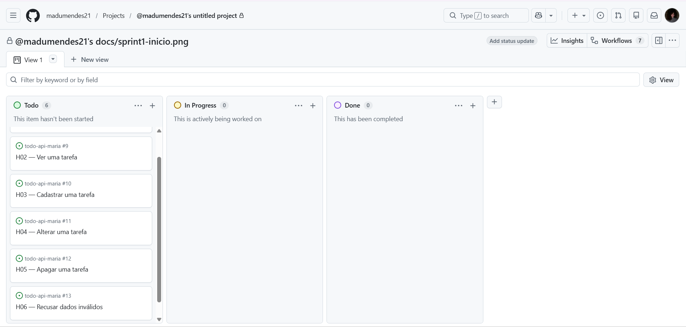
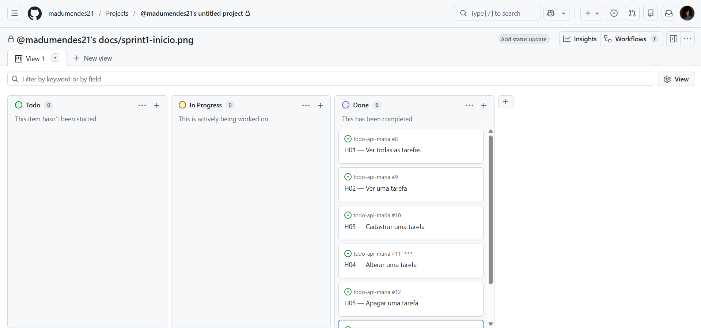
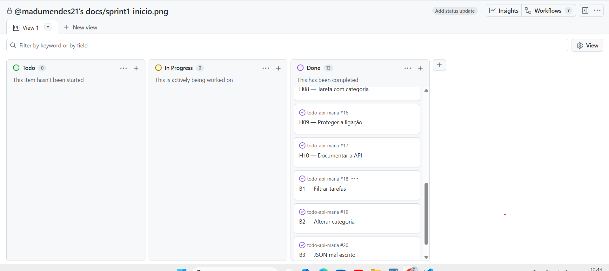

# API de Tarefas — TaskFlow Produtividade

Projeto Final Individual das UCs de **Programação Back-End** e **Projetos de Software** — Curso Técnico em Desenvolvimento de Sistemas  
Escola SENAI "Santo Paschoal Crepaldi" — Turma 1-2026-SESI_DEV_OC_1

API REST desenvolvida com **Node.js**, **Express** e **MySQL** seguindo o padrão **MVC** para organização de tarefas diárias e categorias da empresa **TaskFlow Produtividade**.

---

## Autora

- **Maria Eduarda da Silva Mendes** — [@madumendes21](https://github.com)

---

## Tecnologias

| Tecnologia | Uso | Versão |
| :--- | :--- | :--- |
| **Node.js** | Ambiente de execução JavaScript | 18+ |
| **Express** | Criação do servidor HTTP e gerenciamento de rotas | ^5.2.1 |
| **mysql2** | Conexão com o banco de dados MySQL (com Promises) | ^3.24.6 |
| **dotenv** | Carregamento de variáveis de ambiente via `.env` | ^18.0.9 |
| **nodemon** | Reinício automático do servidor em desenvolvimento | ^3.1.14 |
| **MySQL** | Banco de dados relacional (`todo_db`) | 8.0 |

---

## Como executar o projeto

**1. Clone o repositório e acesse a pasta**

```bash
git clone https://github.com
cd todo-api-maria
```

**2. Instale as dependências e configure o ambiente**

```bash
npm install
# Crie o arquivo .env baseado no .env.example e configure o DB_NAME=todo_db
# Execute o script src/database/todo.sql no seu MySQL
npm run dev
```

---

## Rotas da API (Endpoints)

Todas as respostas de erro seguem o padrão `{ "erro": "mensagem explicativa" }`.

### Tarefas

| Método | Rota | Descrição | Sucesso | Erros |
| :--- | :--- | :--- | :---: | :---: |
| `GET` | `/tarefas` | Lista todas as tarefas (com `LEFT JOIN` em categorias e filtros `?status=` e `?prioridade=`) | `200` | — |
| `GET` | `/tarefas/:id` | Busca uma tarefa específica pelo ID | `200` | `400`, `404` |
| `POST` | `/tarefas` | Cria uma nova tarefa | `201` | `400` |
| `PUT` | `/tarefas/:id` | Atualiza todos os campos de uma tarefa | `200` | `400`, `404` |
| `PATCH` | `/tarefas/:id` | Atualiza parcialmente os campos enviados de uma tarefa | `200` | `400`, `404` |
| `DELETE` | `/tarefas/:id` | Remove uma tarefa | `204` | `400`, `404` |

### Categorias

| Método | Rota | Descrição | Sucesso | Erros |
| :--- | :--- | :--- | :---: | :---: |
| `GET` | `/categorias` | Lista todas as categorias | `200` | — |
| `GET` | `/categorias/:id` | Busca uma categoria pelo ID | `200` | `400`, `404` |
| `POST` | `/categorias` | Cria uma nova categoria | `201` | `400` |
| `PUT` | `/categorias/:id` | Atualiza o nome de uma categoria (Bônus) | `200` | `400`, `404` |
| `PATCH` | `/categorias/:id` | Atualiza parcialmente uma categoria (Bônus) | `200` | `400`, `404` |
| `DELETE` | `/categorias/:id` | Exclui uma categoria (bloqueia com `409` se houver tarefas vinculadas) | `204` | `400`, `404`, `409` |

---

## Testes e Placar (`npm run conferir`)

* **Sprint 1:** `14 de 14`
* **Sprint 2:** `8 de 8`
* **Bônus:** `5 de 5`

---

## Diagrama de Classes


---

## Quadro Kanban (Sprints 1 e 2)

### Sprint 1 — Início


### Sprint 1 — Fim


### Sprint 2 — Início


### Sprint 2 — Fim


---

## Reflexão Final

1. **Arquitetura MVC:** Separar rotas, controllers e services facilitou a localização de erros e a organização das regras de negócio e consultas SQL.
2. **Maior desafio:** Garantir a integridade entre tabelas (`tarefas` e `categorias`), validando a existência de `categoria_id`, retornando dados via `LEFT JOIN` e prevenindo exclusões com o status `409`.
3. **Divisão em Sprints e Kanban:** Permitiu validar o CRUD básico antes de avançar para os relacionamentos e bônus, mantendo o progresso visualmente rastreável.
